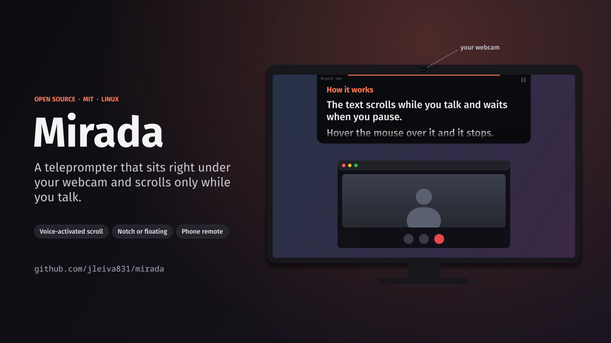
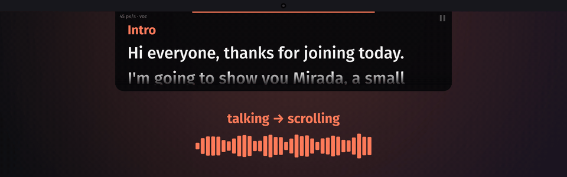

# Mirada

**A teleprompter for Linux.** Mirada shows your script in a strip at the top edge of the screen, right under the webcam, so you can read while keeping eye contact. The text scrolls while you speak and stops when you pause.

[Español](README.md) · [MIT](LICENSE) license





## Features

- **Notch mode:** a strip centered under the webcam, always on top of other windows.
- **Floating mode:** a window you can move and resize.
- **Voice tracking:** scrolls only while you speak. It measures volume locally and never sends audio anywhere.
- **Sections:** lines starting with `#` become sections you can jump to.
- **Remote control** from your phone on the same Wi-Fi (optional, off by default).
- Mirror mode, countdown, text color and size, background opacity.

## Install

### .deb or AppImage (recommended)

Download the file from the [latest release](https://github.com/jleiva831/mirada/releases/latest). Both ship their own Python and Qt, so no internet and no `pip` are needed at install time.

```bash
# Debian 12+ / Ubuntu 22.04+ / Mint / Pop!_OS
sudo apt install ./mirada_VERSION_amd64.deb

# any x86_64 distribution
chmod +x Mirada-VERSION-x86_64.AppImage
./Mirada-VERSION-x86_64.AppImage
```

The `.deb` installs to `/opt/mirada` and provides the `mirada` command; remove it with `sudo apt remove mirada`. The AppImage already contains `xcb-cursor` and PortAudio; without FUSE run it with `--appimage-extract-and-run`. To build them yourself: `bash packaging/build-deb.sh` and `bash packaging/build-appimage.sh` (output in `dist/`, see `packaging/`).

### From source

```bash
git clone https://github.com/jleiva831/mirada.git
cd mirada
bash install.sh
```

The installer puts everything in `~/.local` (no sudo) and adds Mirada to your app menu. You can also run `pipx install git+https://github.com/jleiva831/mirada.git`.

System libraries: PortAudio (for voice tracking) and `xcb-cursor` (for Qt).

- Debian/Ubuntu: `sudo apt install python3-venv libportaudio2 libxcb-cursor0`
- Fedora: `sudo dnf install portaudio xcb-util-cursor`
- Arch: `sudo pacman -S portaudio xcb-util-cursor`

Uninstall with `bash uninstall.sh`. Add `--purge` to also delete `~/.config/mirada`.

## Usage

Open **Mirada** from the menu or run `mirada`. Write or paste your script, then press **▶ Iniciar prompter** (Ctrl+Enter).

| Key | Action |
|---|---|
| Space | Pause / resume |
| ↑ / ↓ | Faster / slower |
| PgUp / PgDn | Previous / next section |
| 1-9 | Jump to section N |
| Home | Back to the start |
| V | Toggle voice tracking |
| N | Toggle notch / floating mode |
| ← / → | Move the notch to line it up with the camera (Shift: faster) |
| M | Mirror mode |
| + / − | Font size |
| Esc | Close the prompter |

The interface is currently in Spanish. Translations are welcome.

### Screens, camera and panels

In **Ajustes** (Settings) you can pick which monitor the prompter uses, where your camera is (center, left, right or an exact percentage) and whether the notch goes below a top panel (default) or over it (for auto-hiding panels). The notch width is a percentage of the screen, so it looks right on a 1366 px laptop and on a 4K monitor. Mirada repositions itself when the resolution, panel or monitors change, and redraws less often while paused to save battery.

## Limitations on Linux

- **Wayland:** Mirada runs through XWayland so it can stay pinned on top. Set `MIRADA_WAYLAND=1` to force native Wayland, which may lose always-on-top.
- **Screen sharing:** Linux has no standard way to hide a window from captures. Share a single window instead of the whole screen.
- **Voice:** it detects that you're speaking from the volume; it doesn't recognize words.

## Development

```bash
python3 -m venv .venv && . .venv/bin/activate
pip install -e '.[dev]'
ruff check . && pytest
python -m mirada
```

## License

[MIT](LICENSE). Mirada uses [Qt for Python (PySide6)](https://doc.qt.io/qtforpython/), which is licensed under the LGPL-3.0.
